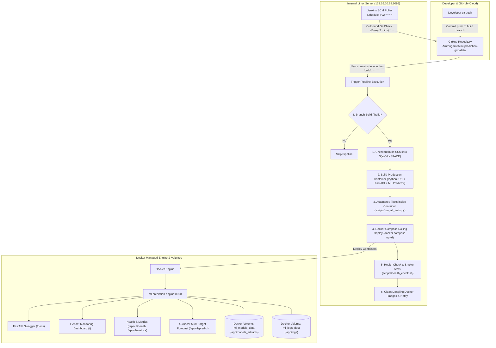

# Implementation Plan: Linux Server Hosting with Jenkins SCM Polling CI/CD (Updated)

## Goal Description
Automate the continuous integration and deployment (CI/CD) of the **Energy Consumption Forecasting ML Engine (Grid Data)** directly from Jenkins on the internal Linux server (`172.16.10.29`) using **Jenkins SCM Polling** (`H/2 * * * *`), eliminating the need for public webhooks or separate host layouts (`/opt/ml-prediction/`).

- **Trigger**: **Jenkins SCM Polling (`H/2 * * * *`)** checks GitHub every 2 minutes for new commits on the **`build` (or `Build`) branch**.
  - *No public IP or port forwarding required*: Jenkins initiates outbound HTTPS calls to GitHub, solving the `failed to connect to host` error on private IP `172.16.10.29`.
- **Jenkins Instance**: Pre-installed Jenkins running on **port `8096`** (`http://172.16.10.29:8096`).
- **No `/opt/...` Layout**: All build, orchestration, docker containers, and data management run self-contained directly within the Jenkins workspace repository directory (`${WORKSPACE}`), using standard Docker Named Volumes (`ml_models_data`, `ml_logs_data`) managed directly by the Docker daemon.

---

## 1. System Architecture & Trigger Flow (SCM Polling)



---

## 2. Directory & Storage Strategy (Workspace-Centric + Docker Managed Volumes)

### No `/opt/ml-prediction/` Directory Required
Instead of maintaining a separate `/opt/...` host layout:
- Everything executes directly inside the **Jenkins Workspace** (`/var/lib/jenkins/workspace/ml-prediction-grid-data-pipeline/`).
- **Persistent Data**: Handled completely via **Docker Named Volumes** managed natively by Docker Engine (`/var/lib/docker/volumes/...`):
  - `ml_models_data`: Persists trained model weights (`models_artifacts/xgboost/`), versions, and `latest.json`.
  - `ml_logs_data`: Persists application logs.
- **Configuration Files**: Provided directly from repository's `config/` directory (`config.yaml` and `model_config.yaml`).
- **Environment Secrets**: Sourced from Jenkins Credential Store into `${WORKSPACE}/.env` or passed via environment variables during deployment.
- **Logs**: Docker logs accessible via `docker compose logs` and optional local `./logs` folder within the workspace.

---

## 3. Jenkins Workspace Layout

```
/var/lib/jenkins/workspace/ml-prediction-grid-data-pipeline/  <-- Auto-created by Jenkins on build
├── .git/                                                    <-- Cloned Git repository (tracking build branch)
├── .env                                                     <-- Sourced from Jenkins Credentials / production.env.example
├── Jenkinsfile                                              <-- Declarative Pipeline with pollSCM('H/2 * * * *')
├── Dockerfile                                               <-- Python 3.11-slim FastAPI + ML container
├── .dockerignore                                            <-- Excludes cache, logs, virtual environments
├── requirements.txt                                         <-- Production Python dependencies
├── genset-dashboard.html                                    <-- Frontend UI for Energy Forecasting
├── grid_data.parquet                                        <-- Historical telemetry dataset
├── run_pipeline.py                                          <-- Standalone ML training pipeline runner
├── api/                                                     <-- FastAPI Application
│   ├── main.py                                              <-- Root router & CORS
│   └── routes/
│       ├── health.py                                        <-- Healthcheck & active model endpoint
│       ├── predict.py                                       <-- Multi-target forecast endpoint
│       ├── metrics.py                                       <-- Model validation metrics endpoint
│       └── train.py                                         <-- Dynamic model re-training endpoint
├── config/                                                  <-- Model & pipeline YAML configurations
│   ├── config.yaml
│   └── model_config.yaml
├── data_preparation/                                        <-- Telemetry loader & resampler
├── feature_engineering/                                     <-- Time & lag feature generators
├── models_artifacts/                                        <-- Model weights registry & latest pointer
├── quality_gate/                                            <-- R2 / RMSE / MAPE model evaluator
├── serving/                                                 <-- EnergyPredictor inference service
├── deploy/                                                  <-- Deployment specifications
│   ├── docker-compose.prod.yml                              <-- Production Compose file with Docker Named Volumes
│   └── production.env.example                               <-- Production environment template
├── logs/                                                    <-- Local workspace logs folder (Auto-created)
└── scripts/                                                 <-- Build, test & deployment scripts
    ├── run_all_tests.py                                     <-- Automated verification test suite
    ├── run_tests.sh                                         <-- Container/virtualenv wrapper test runner
    ├── deploy.sh                                            <-- In-workspace deployment runner
    └── health_check.sh                                      <-- Health & Smoke test script
```

---

## 4. Trigger Configuration: Jenkins SCM Polling (`H/2 * * * *`)

### Why SCM Polling is Used Here:
- The Linux server uses a private local IP (`172.16.10.29`).
- GitHub cannot reach `http://172.16.10.29:8096/github-webhook/` without an external public domain or tunnel.
- With **SCM Polling**, Jenkins initiates the connection **outbound** to GitHub over HTTPS port 443 every 2 minutes. No inbound ports or router changes are required.

### Jenkins Pipeline Trigger Definition:
```groovy
pipeline {
    agent any

    triggers {
        // Poll GitHub every 2 minutes for changes on 'build'
        pollSCM('H/2 * * * *')
    }

    environment {
        PYTHONUNBUFFERED = '1'
        APP_PORT = '8000'
        IMAGE_NAME = 'ml-prediction-engine:latest'
    }

    stages {
        stage('Branch Validation') {
            steps {
                script {
                    def branch = env.BRANCH_NAME ?: env.GIT_BRANCH ?: ''
                    def cleanBranch = branch.replaceAll('^origin/', '').replaceAll('^refs/heads/', '')
                    if (cleanBranch != 'build' && cleanBranch != 'Build') {
                        currentBuild.result = 'NOT_BUILT'
                        error("Skipping: Not on Build branch")
                    }
                }
            }
        }
        stage('Checkout SCM') {
            steps {
                checkout scm
            }
        }
        stage('Build Container Image') {
            steps {
                echo "Building production container image: ${IMAGE_NAME}..."
                sh "docker build -t ${IMAGE_NAME} -f Dockerfile ."
            }
        }
        stage('Run Automated Tests') {
            steps {
                echo "Executing automated test suite inside isolated container environment..."
                sh "docker run --rm ${IMAGE_NAME} python scripts/run_all_tests.py"
            }
        }
        stage('Build & Deploy Stack') {
            steps {
                sh 'bash scripts/deploy.sh'
            }
        }
        stage('Smoke & Health Tests') {
            steps {
                sh 'bash scripts/health_check.sh'
            }
        }
    }

    post {
        always {
            sh 'docker image prune -f || true'
        }
        success {
            echo "✅ ML Prediction Grid Data Stack successfully verified and deployed!"
        }
        failure {
            echo "❌ Pipeline failed! Review stage logs above."
        }
    }
}
```

---

## 5. Jenkins UI Configuration (Step-by-Step for Port 8096)

1. Open `http://172.16.10.29:8096` in your browser.
2. Select your job **`ml-prediction-grid-data-pipeline`** ➔ Click **Configure**.
3. Under **Build Triggers**:
   - ❌ **Uncheck** "GitHub hook trigger for GITScm polling" *(since GitHub cannot connect in)*.
   - ✅ **Check "Poll SCM"**.
   - In the **Schedule** text box, enter:
     ```text
     H/2 * * * *
     ```
     *(The `H` distributes load and polls approximately every 2 minutes).*
4. Under **Pipeline**:
   - **Definition**: Pipeline script from SCM.
   - **SCM**: Git.
   - **Repository URL**: `https://github.com/Arumugam66/ml-prediction-grid-data.git`
   - **Branch Specifier**: `*/build`
   - **Script Path**: `Jenkinsfile`
5. Click **Save**.

---

## 6. Implementation Status (All Artifacts Created & Updated)

- [x] **Updated `Jenkinsfile`**: Added `triggers { pollSCM('H/2 * * * *') }`, automated container build (`Build Container Image`), and container-isolated testing (`docker run --rm ${IMAGE_NAME} python scripts/run_all_tests.py`).
- [x] **`Dockerfile` & `.dockerignore`**: Python 3.11-slim container with FastAPI, XGBoost, scikit-learn, pyarrow, and built-in container healthcheck.
- [x] **`requirements.txt`**: Complete production dependencies specification (fastapi, uvicorn, scikit-learn, xgboost, pyarrow, pandas, pyyaml).
- [x] **`deploy/docker-compose.prod.yml`**: Explicit `image: ml-prediction-engine:latest` tag, Docker Named Volumes (`ml_models_data`, `ml_logs_data`), internal network `ml-grid-net`, container healthchecks, and auto-restart policy.
- [x] **`deploy/production.env.example`**: Complete production environment template with port, log level, and config file specifications.
- [x] **`scripts/run_all_tests.py`**: Self-contained automated test suite validating configuration schemas, module imports, model registry integrity (v9), telemetry loader, and FastAPI routes.
- [x] **`scripts/run_tests.sh`**: Dual-mode test runner that automatically executes inside Docker container if host Python lacks dependencies (e.g. `sklearn`, `uvicorn`, `pyarrow`).
- [x] **`scripts/deploy.sh`**: Self-contained deployment runner executing in Jenkins workspace; builds/tags image, restarts containers, waits for health endpoint, and prunes unused build cache.
- [x] **`scripts/health_check.sh`**: Automated post-deployment smoke test suite verifying `/api/v1/health`, `/api/v1/sites`, `/api/v1/metrics`, `/docs`, and `/` frontend dashboard.

---

## 7. Verification Plan

### Automated Verification
1. Push a commit to the `build` branch on GitHub:
   ```bash
   git add .
   git commit -m "Fix CI/CD: run automated tests inside Docker container to resolve missing host Python dependencies"
   git push origin build
   ```
2. Wait up to 2 minutes:
   - Jenkins SCM poller detects the new commit.
   - Jenkins automatically launches a new build.
   - Stage 1: Branch Validation (passes for `build`)
   - Stage 2: Checkout SCM
   - Stage 3: Build Container Image (`ml-prediction-engine:latest` built with all requirements)
   - Stage 4: Run Automated Tests (all 5 test groups pass inside container)
   - Stage 5: Build & Deploy Stack (Docker Compose starts container)
   - Stage 6: Smoke & Health Tests (all 5 endpoints return HTTP 200)

### Manual Verification
1. Open Jenkins job console: `http://172.16.10.29:8096/job/ml-prediction-grid-data-pipeline/`.
2. Inspect pipeline execution stages.
3. Confirm API & Dashboard is running:
   ```bash
   curl http://172.16.10.29:8000/api/v1/health
   ```

---

## 8. Incident Analysis & Resolution: Missing Host Python Dependencies

### Root Cause
In previous pipeline runs, `scripts/run_all_tests.py` was invoked directly on the bare host machine (`python3 scripts/run_all_tests.py`).
The Linux Jenkins host (`172.16.10.29`) only has base Python installed without data science/ML packages (`scikit-learn`, `uvicorn`, `pyarrow`).
Consequently, the test suite reported:
- `Import: quality_gate.evaluator (No module named 'sklearn')`
- `Import: api.main (No module named 'uvicorn')`
- `Telemetry Loader Check (Missing optional dependency 'pyarrow')`
- `FastAPI Route Registration (No module named 'uvicorn')`

### Resolution
1. **Container-Isolated Testing**: The pipeline now builds `ml-prediction-engine:latest` before testing, and runs `docker run --rm ml-prediction-engine:latest python scripts/run_all_tests.py`. Inside the container, all dependencies from `requirements.txt` are already installed and verified.
2. **Zero Host Dependency**: The Jenkins host agent requires no pip packages, virtual environments, or compilation tools.
3. **Image Cache Reuse**: The image tested in Stage 4 is immediately deployed in Stage 5 via `docker compose`, ensuring complete environment fidelity between testing and production.

---

## 9. Incident Analysis & Resolution: FastAPI `_IncludedRouter` AttributeError

### Root Cause
FastAPI $\ge$ 0.137.0 stores included sub-routers as `_IncludedRouter` instances rather than flattening them into `app.routes`. Because `_IncludedRouter` does not have a `.path` attribute, reading `route.path` in `scripts/run_all_tests.py` caused:
```text
AttributeError: '_IncludedRouter' object has no attribute 'path'
```

### Resolution
Updated `scripts/run_all_tests.py` to inspect registered routes via `app.openapi().get("paths", {})` and safe `hasattr(r, "path")` checks. This guarantees compatibility across all current and future versions of FastAPI and Starlette without requiring dependency downgrades.
